# BucketList

A mobile web prototype for **find a court → join a scheduled game → set up your team → coordinate and play**. After a brief first-visit welcome, it opens to the full-screen court map; returning signed-in profiles go straight to the map. It follows the supplied mobile reference: hamburger navigation, basketball-pin marker, compact court popup, expandable court/game panels, and Stats / Search / Chat navigation. The orange/black/white design system carries through the app, with light/dark/device themes.

## Put it on your phone

**Open on your phone: https://adoblake.github.io/making-bucketlist/**

The public site and its manifest, service worker, app icon, and QR image return HTTP 200. The hosted HTML was verified to match the current build. [QR code for showing/printing](docs/share-qr.png). Site files are published on the **gh-pages** branch.

- **iPhone:** open the HTTPS link in Safari → Share → Add to Home Screen. Enable Open as Web App if offered.
- **Android:** open in Chrome → menu → Install app / Add to Home screen.
- **Icon:** the same basketball pin used in the app, with only orange and charcoal; no lettering. PNG sizes support home screens, with an SVG favicon for browser tabs.
- **Sharing:** menu → Share app · show QR. Native share and copy-link controls help pass it around in person.
- **Offline:** after a successful first visit, the app shell and local showcase can reopen offline. Maps and live park search still need Internet. The service worker only caches this app's own files, not external map tiles or directory requests.

The hosted phone test was attempted, but this cloud Chromium rejected the environment’s HTTPS proxy certificate. TLS verification was not disabled. Public HTTPS responses were independently verified using the environment’s trusted CA bundle, and mobile subpath/manifest/offline behavior passed against the same build on a local test server. A physical iPhone/Android installation has not been tested.

This is an installable mobile web demo, not an App Store build. Each phone has its own browser-local data. Chat, reservations, and profiles are not synchronized between phones.

To verify the built phone package locally: run `npm run build:web`, then `npm run preview:web` in a separate terminal, then `npm run test:phone` (set `BROWSER_EXECUTABLE` when using a system Chromium). The default test checks the same repository subpath used by Pages, including offline service-worker reload.

To update the site from the source checkout, run `npm ci` then `npm run publish:web`. This builds the standalone/PWA artifacts and pushes the site to the existing gh-pages branch without force-pushing. Pages is now serving the site. If it ever needs reconfiguration, use repository Settings → Pages → Deploy from a branch → gh-pages / (root).

## Calendar and guest-profile flow

Game creation uses a seven-day date strip, previous/next week, optional date jump (180-day planning horizon), Morning/Afternoon/Evening lists, and 30-minute start intervals. Choose a 30/60/90/120-minute duration, confirm the time range, and review it in the game form. Back/cancel preserves form fields and the previously confirmed time. Past times are hidden/rejected; month/year/leap-day and DST boundaries are tested. Times explicitly use the device's timezone, not an inferred park timezone. Start/end instants and duration persist and appear in game views. Proposed ranges are not court reservations or verified park hours.

Guests can browse parks, basic game details, play style, and roster counts. Player identities, personal stats, team participation, and messages require a local demo profile. Contextual prompts explain crew/team continuity, chat, stats, and privacy; a populated showcase can be explored before creating a profile. The prototype profile is saved only in the browser and is not a secure online account. Production enforcement needs authenticated server authorization.

| Light time picker | Dark time picker | Profile benefits |
| --- | --- | --- |
| 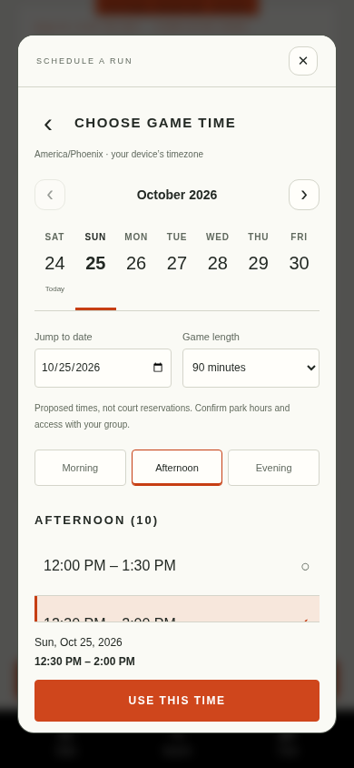 | 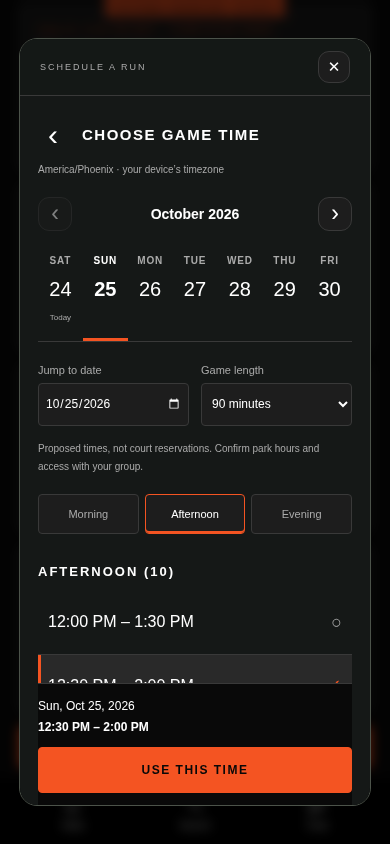 | 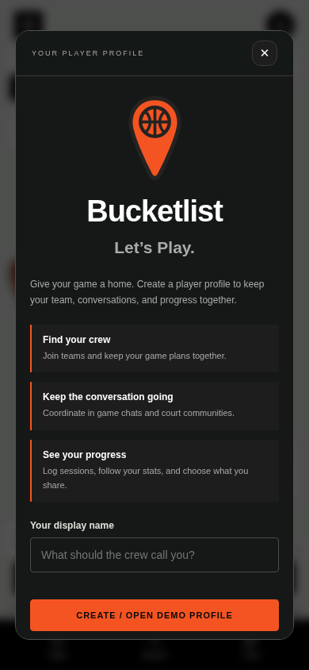 |

## Open it without installing anything

Choose **Code → Download ZIP** on GitHub, extract the archive, and open **BucketList.html** in your browser. The styles and scripts are included in that file. Street map tiles need Internet access. The map uses Leaflet/OpenStreetMap so our basketball pins can be geographically anchored. Google Maps remains available for directions. If tiles are blocked, a status message explains that the court pins remain available; no fake street geography is shown.

This is a local prototype, not a native iOS/Android release or a multiplayer service. Fictional players and sample games are labeled. Changes stay in browser storage; chats are not delivered to other people.

## Opening sequence

First-time guests see a two-step welcome with profile benefits and a guest skip. Returning visitors open directly to the map. The app requests browser location permission to center on the user, with a blue location dot and accuracy circle. If permission is denied or location fails, an explicit status explains the fallback Phoenix map and manual search remains available. No profile form is mandatory. The default **All basketball parks** mode keeps parks selectable even when no games are scheduled. **Games with open spots** is a separate optional filter. Tap its basketball pin, then tap the court name in the popup for court details, games, and teams. The popup and bottom bar both offer **Start a game**. In Games with open spots mode, time and play-style filters remove pins for full, past, cancelled, or nonmatching games. In All basketball parks mode, game availability does not hide a venue. Availability here does not mean verified live court occupancy. Search opens a court-search overlay with time/play-style filters. My Games, Profile, and the theme toggle are in the hamburger menu.

Guests can browse public court/game details. Joining a team, organizing a game, accessing personal screens, and chatting require the clearly labeled **local demo sign-in**. Enter a display name to exercise that sequence, or continue browsing. No account is created, no password is collected, and there is no authentication server. The demo remembers a signed-in profile across reloads and new tabs on the same browser/device; sign-out is in Profile and prevents automatic re-entry. Existing named local profiles migrate to the returning-player flow. Device-local data is retained after sign-out. This UI gate is not a security boundary.

## Explore the populated showcase

Tap **Explore 90-day player demo** on the map or in the menu. It opens the fictional Marcus Rivera profile with 24 self-reported sessions over roughly three months, a progress chart and first/latest-session averages, 1,320 demonstration minutes, three named teams, three court communities, upcoming games, completed session details, and group conversations with fictional participants. Jump from stats to games, chats, or profile.

Showcase state is stored separately from your personal demo state. Its edits survive reloads. **Exit showcase · restore my data** in the menu returns to your preserved personal data. **Restart populated showcase** deliberately restores its starting sample. No fictional performance, attendance, or conversation represents a real person or reservation.

## Where the courts come from

**The bundled Phoenix directory contains 125 basketball locations**, backed by the City of Phoenix Parks and Recreation public GIS. The bundled snapshot preserves all **155 individual court records** and adds parks whose city record lists basketball without a separate court point. Case differences and known naming aliases are merged. These are real city-directory locations; the games, people, and showcase remain fictional.

The original issue was that only five starter venues were bundled and additional results depended on an unreliable Overpass query. Phoenix no longer depends on that query: its directory is part of the app build and offline shell, with no extra button required. Search and map pins show only matching courts inside the current map bounds. Pan/zoom updates results automatically without refitting the camera. All 125 Phoenix entries remain available as you explore or search a destination, and map clusters expand as you zoom. A selected court keeps its orange pin; neighboring pins are grouped to avoid overlap. Parks remain selectable without a game.

Court details show the city source, retrieval date, mapped court count, address, and listed amenities. Coordinates come from actual city basketball points when available; supplemental entries explicitly say **park record**. Source listings do not confirm current access, maintenance, hours, reservations, or live occupancy.

Sources: [City public GIS](https://services.arcgis.com/cfKakmeHE95cgeEK/arcgis/rest/services/ParksOpenData/FeatureServer), basketball layer **0**, park layer **10**; ArcGIS item owned by **City_of_Phoenix**. `public/data/phoenix-courts.js` records retrieval metadata and the public source URL. Update it using `npm run refresh:courts`, then rebuild/publish. The refresh was exercised against the real service and returned 125 locations/155 court records. Node 24's environment-proxy support is used automatically when available; it does not disable TLS verification.

Coverage is currently strongest for **Phoenix city limits**. Scottsdale/Austin retain starter venues; all areas can supplement saved entries by automatically requesting tagged basketball courts inside the visible map bounds using OpenStreetMap/Overpass, after a short debounce. Lookups require zoom level 11 or closer and a bounded area. Older requests are aborted when the camera changes; provider failures retain saved results with an explicit status. That external lookup has returned errors/timeouts and is not guaranteed complete. This release does not claim complete coverage of all metro cities or the world. Existing cached court references, saved games, and chat groups are preserved when a duplicate location gets a city-backed entry.

| All Phoenix locations | Search directory | City-backed court details |
| --- | --- | --- |
| 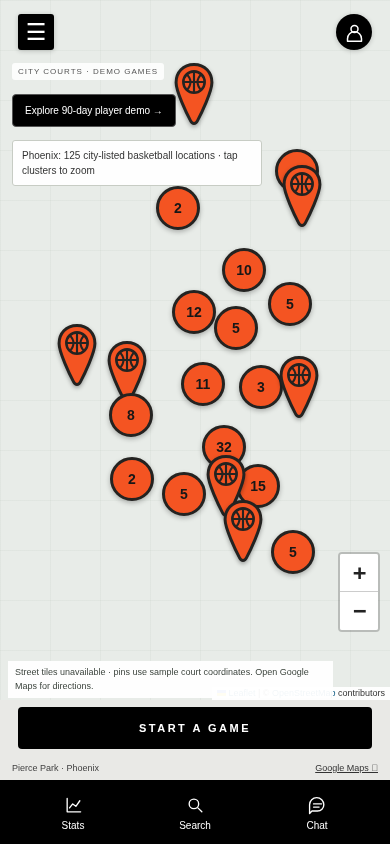 | 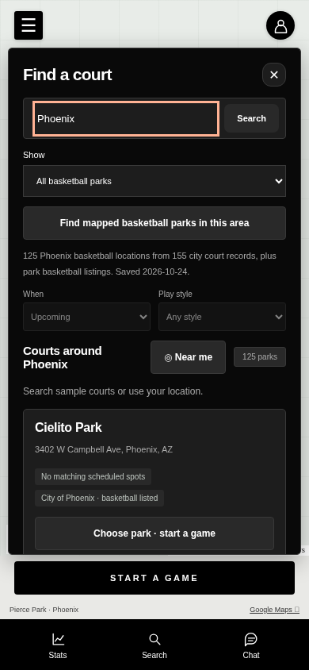 | 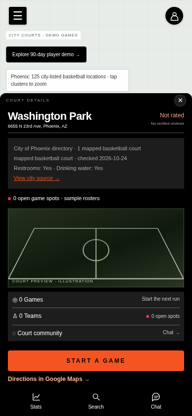 |

## What you can try

- **Courts:** search Phoenix, Scottsdale, or Austin; select a sample court, tap its marker/popup, and pan/zoom the map with geographically anchored pins; open court details, directions, scheduled games, or its lasting community chat. Geolocation centers the map on the user; the visible map bounds filter both court pins and search results. The location-arrow button recenters at any time. Destination search moves the map, while court-name search narrows results inside that area.
- **Scheduled games:** join the roster, select/switch between capacity-limited Team A/B, and name your team within that game. Create a future game with a court, player limit, play style, and meeting/access notes.
- **Chat:** separate court-community and game-group conversations, plus a central chat list.
- **My stats:** log and delete personal session records for points, rebounds, and assists; see self-reported averages and history.
- **Profiles:** open a player from a roster. Fictional examples demonstrate public and private profiles/stats. Your profile details and stats have independent sharing settings, both off by default; preview what others would see. Display names remain visible on rosters.
- **Appearance:** use the hamburger-menu toggle or select Light, Dark, or Use device setting in Profile, then save. Themes persist. The street basemap retains its readable provider styling in both themes. The map footer credits OpenStreetMap tiles; Phoenix location details separately credit the city directory.

## Screenshots

Captured on a mobile viewport. Street tiles are blocked in the cloud screenshots. Markers are geographically projected against a neutral grid; it is not street imagery.

| Opening map | Court popup | Court details |
| --- | --- | --- |
| 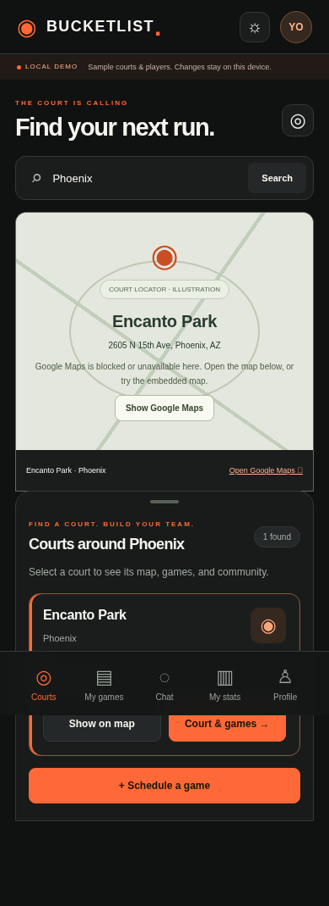 | 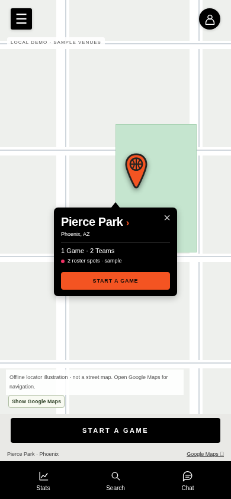 | 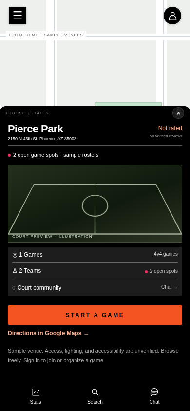 |

| Teams | Demo sign-in | Light theme |
| --- | --- | --- |
| 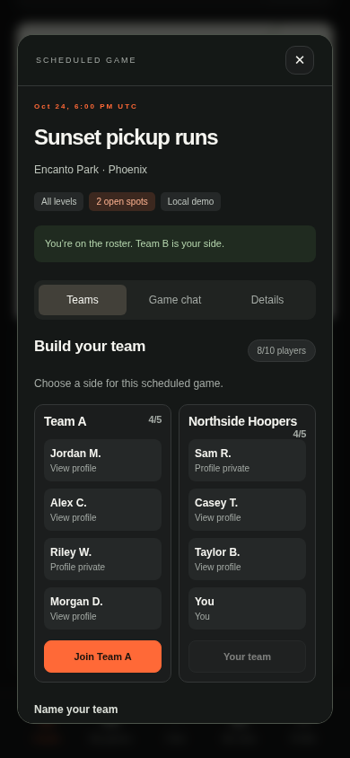 | 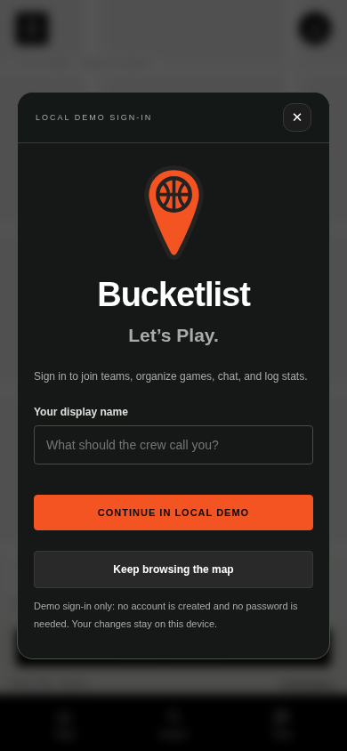 | 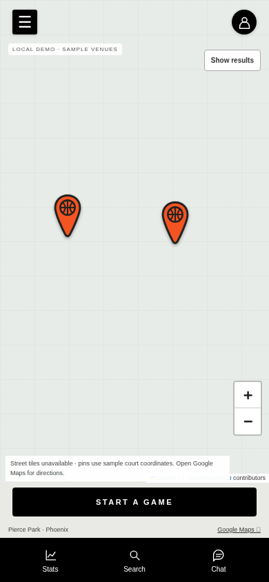 |

## Development

Requires Node.js 22+ and npm.

```sh
npm ci
npm start
```

Open the server on port 3000 (`PORT` overrides it). The server uses Node built-ins. Leaflet 1.9.4 is pinned and its licensed distribution is bundled in public/vendor/leaflet so the standalone artifact needs no CDN scripts. Playwright is a development-only dependency.

```sh
npm test                 # HTTP, team-capacity, privacy projection, and stats tests
npm run build            # regenerate the downloadable BucketList.html
```

Browser regression checks require a running server and Chromium:

```sh
# Terminal 1
PORT=3090 npm start
# Terminal 2, if Chromium is already installed
APP_URL=http://127.0.0.1:3090 BROWSER_EXECUTABLE=/usr/bin/chromium npm run test:browser
```

If no Chromium is installed, run `npx playwright install chromium` and omit `BROWSER_EXECUTABLE`. The browser suite checks automatic map opening, guest browsing, local-demo sign-in gates/cancel/resume/sign-out, and team switching/naming, separate chats, profile visibility, stats, persistence, destination search, themes, responsive overflow, and the standalone artifact. Run `APP_URL=http://127.0.0.1:3092 BROWSER_EXECUTABLE=/usr/bin/chromium npm run test:showcase` with a server on 3092 for the populated-showcase and fixture-directory regression. Marker projection, keyboard activation, viewport filtering, and availability filters are checked; run `APP_URL=http://127.0.0.1:3097 npm run test:location` against a server on 3097 for welcome steps, permitted/denied geolocation, pan/zoom/list agreement, destination discovery, recenter, cross-tab profile restoration, and explicit sign-out. External tile availability is not asserted because the cloud environment blocks the tile provider.

## Maps and privacy boundaries

The map uses Leaflet 1.9.4, Leaflet.markercluster 1.5.3, and OpenStreetMap street tiles with visible attribution, custom geographic basketball pins, pan/zoom, court popups, a current-location marker, and viewport-scoped results. Popups and result updates do not move the camera. Google Maps directions open only when requested. No Maps API key is required for this prototype. A custom Google-powered map can replace this provider when the required API configuration is supplied. Public OSM tiles have a usage policy and no app-specific uptime guarantee; production must provision an appropriate provider.

Phoenix coordinates and amenity labels come from city records; starter-venue coordinates elsewhere remain unverified. Current access, hours, occupancy, and conditions are not verified. All basketball parks is the default directory mode. The separate Games with open spots mode uses future scheduled games and selected day/style. Neither mode claims live court occupancy. Self-reported sample availability is not a court reservation. In Games with open spots, pins and list both exclude courts without a matching game; switch to All basketball parks to see those venues.

Precise user coordinates stay in memory and are not saved in the profile; there is no background tracking. Visible map bounds are sent to Overpass for area discovery for the visible area, and destination text goes to Nominatim. Normal map viewport tile requests go to OpenStreetMap; opening directions sends the chosen public venue to Google. Stats/profile visibility remains a local UI demonstration, not server authorization. Real privacy, team reservations, and message delivery require authenticated shared storage.

See [UX decisions and standard references](docs/UX-DECISIONS.md) for the applied conventions, source-access limitations, and remaining production work. The new published Figma site also could not be retrieved through the cloud proxy.

## Showcase screenshots

| Player stats and progress | Upcoming games and history |
| --- | --- |
| 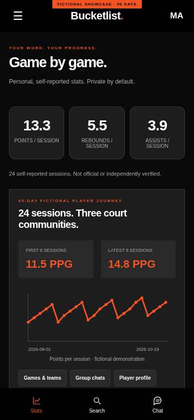 | 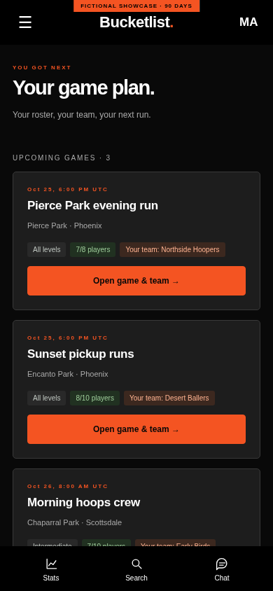 |

## Next production milestones

Authentication; shared games and atomic capacity reservations; realtime chat; server-enforced profile permissions; host controls/cancellation; waitlists; notifications; reporting/blocking and moderation; verified courts/accessibility; real Maps/Places integration; native packaging and device testing.

The business plan and layout screenshot informed this version. The Figma links and reference GitHub repository were inaccessible. See [PRODUCT.md](PRODUCT.md) for the product direction.
